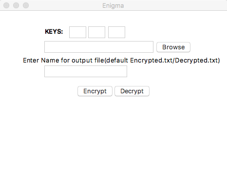

# Enigma: Digital Twin of the WW2 Cipher Machine

## About the Original Enigma Machine
The Enigma machine was an electro-mechanical rotor cipher device used primarily by Nazi Germany during World War II to encrypt military communications. Invented by the German engineer Arthur Scherbius at the end of World War I, the machine became famous for its complex internal mechanism, which included rotors, a plugboard, and a reflector. The Enigma's encryption was considered unbreakable at the time, but Allied cryptanalysts, most notably at Bletchley Park in the UK, managed to break its codes, significantly influencing the outcome of the war.

### Internal Mechanism Diagram
Below is a diagram showing the internal working mechanism of the original Enigma machine:

*Source: [Wikimedia Commons](https://commons.wikimedia.org/wiki/File:Enigma-machine-diagram-en.svg)*

## About This Repository
This repository is a digital twin (software clone) of the original Enigma machine. It simulates the encryption and decryption process inspired by the historical device, allowing users to experience how messages were encoded and decoded. While the implementation may simplify some aspects for usability, it captures the essential logic and spirit of the Enigma cipher.

---

## Version 1.0
**Simple Python script for Encryption/Decryption with GUI**

**Tkinter used for GUI**

**Simply replaces a string with another string set for it.**

	- Modify Og_string or semiog_string for different results.

**Targeted for Large Data**

## Version 2.0
**_Keys Added_**

**Keys to be typed for Encrypting and Decrypting and they should be Checked**

	- Key size should be between 1-62

## Version 3.0
**User can change name of output file.**

Please Feel free to share Thank You!.

Contact:- doke.akshen@gmail.com
